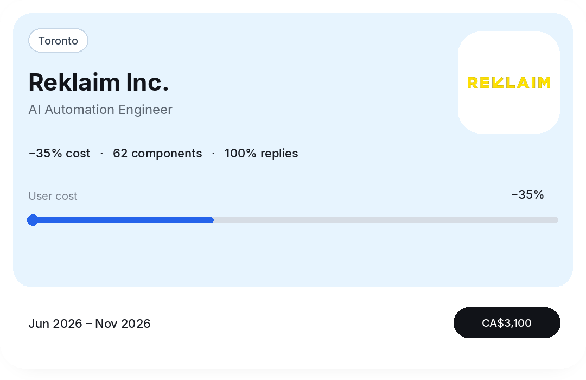

# Devang Parekh

AI Automation Engineer · Toronto

I build agentic systems and the services under them. Reklaim ran through November 2026. Open to the next role.

## Experience

<table width="100%">
<tr>
<td width="50%" valign="top">

</td>
<td width="50%" valign="top">

</td>
</tr>
<tr>
<td width="50%" valign="top">

</td>
<td width="50%" valign="top">

</td>
</tr>
</table>

## Work

- **[Agentable.io](https://github.com/BravesDevs/Agentable.io)** — Visual agent builder. Each flow ships as a REST endpoint. Next.js, Mastra, Postgres.
- **[Finlysis](https://github.com/BravesDevs/Finlysis)** — Finance API. Plaid, CSV import, spending analytics. NestJS, Prisma, MySQL.
- **[Infralens](https://github.com/BravesDevs/ConHacks2026)** — Terraform right-sizing, opened as a pull request. FastAPI, React, Postgres. ConHacks 2026.
- **[Gujarati dialect detection](https://github.com/BravesDevs/Gujarati-Accent-Detection)** — Five dialect labels on Gujarati transcripts. Django, Keras.

## Stack

TypeScript, JavaScript, Python, Java, SQL. React, Next.js, Node.js, NestJS, Spring Boot, FastAPI. PostgreSQL, MySQL, MongoDB, Pinecone. AWS, Docker, NGINX.

## Education

**Conestoga College** — Graduate Certificate, Web Development · Kitchener · Sep 2023 – Dec 2024

**Dharmsinh Desai University** — B.E., Computer Engineering · Nadiad · Aug 2018 – May 2021

## Contact

[Portfolio](https://gigforge.io/p/devangparekh) · [LinkedIn](https://linkedin.com/in/bravesdevs) · [X](https://x.com/BravesDevs) · [LeetCode](https://leetcode.com/devangmp) · [Email](mailto:devangparekh2014@gmail.com)
