<!--
  Profile README for https://github.com/BravesDevs
  Same layout as https://github.com/de-waang, with this account's roles,
  dates, and projects. Reklaim ended November 2026.
  Stat cards and the contribution snake in ./profile refresh from
  .github/workflows/profile-cards.yml.
-->


<p align="center">
  <a href="https://git.io/typing-svg">
    
  </a>
</p>

<p align="center">
  
  <a href="https://github.com/BravesDevs?tab=followers">
    
  </a>
  <a href="https://github.com/BravesDevs?tab=repositories">
    
  </a>
</p>


<h2>  About </h2>


```ts
const devang = {
  role: "AI Automation Engineer",
  location: "Toronto, ON, Canada",
  lastRole: "Reklaim · Jun 2026 – Nov 2026",
  focus: ["Agentic AI", "RAG Pipelines", "LLM Workflow Automation"],
  stack: {
    ai: ["Mastra", "RAG", "Pinecone", "Hugging Face", "Prompt Engineering"],
    languages: ["TypeScript", "JavaScript", "Python", "Java", "SQL"],
    backend: ["Node.js", "NestJS", "Next.js", "FastAPI", "Spring Boot"],
    data: ["PostgreSQL", "MongoDB", "MySQL", "Vector DBs"],
    devops: ["AWS", "Docker", "NGINX", "GitHub Actions", "Linux"],
  },
  currentlyBuilding: "Agentable.io — visual AI agent builder",
};
```

<br clear="right"/>

- Most recently **AI Automation Engineer at Reklaim** through November 2026. Monthly user cost **−35%** (CA$4,800 → CA$3,100) and **62** shared UI components
- At **Playgrnd**, **2** agents automated **98%** of a manual workflow and raised counterparty profit **35%**
- Built **QueryGen** at FIYGE: **500+** tables vectorized, retrieval accuracy **+60%**
- Creator of **[Agentable.io](https://github.com/BravesDevs/Agentable.io)** — drag-and-drop AI agent builder
- Open to the next role in agentic systems, retrieval, and backend platforms


<h2> 💼 Experience </h2>

<table>
  <tr>
    <td><strong>Reklaim Inc.</strong> — Toronto, Ontario</td>
    <td align="right"><strong>Jun 2026 – Nov 2026</strong></td>
  </tr>
  <tr>
    <td colspan="2"><strong>AI Automation Engineer</strong></td>
  </tr>
  <tr>
    <td colspan="2">
      • Slack MCP and custom skills, removing robotic replies in that flow<br/>
      • Langfuse telemetry cut monthly user cost by <strong>35%</strong>, CA$4,800 → CA$3,100<br/>
      • Semantic UI package, <strong>62</strong> shared components
    </td>
  </tr>
</table>

<table>
  <tr>
    <td><strong>Playgrnd</strong> — Toronto, Ontario</td>
    <td align="right"><strong>Nov 2025 – May 2026</strong></td>
  </tr>
  <tr>
    <td colspan="2"><strong>Full Stack AI Engineer</strong></td>
  </tr>
  <tr>
    <td colspan="2">
      • <strong>2</strong> agents automated <strong>98%</strong> of the manual workflow<br/>
      • Counterparty profit <strong>+35%</strong><br/>
      • Prisma and PostgreSQL schema across <strong>6</strong> services
    </td>
  </tr>
</table>

<table>
  <tr>
    <td><strong>FIYGE Research Inc.</strong> — Toronto, Ontario</td>
    <td align="right"><strong>Dec 2024 – Oct 2025</strong></td>
  </tr>
  <tr>
    <td colspan="2"><strong>Software Engineer</strong></td>
  </tr>
  <tr>
    <td colspan="2">
      • QueryGen vectorized <strong>500+</strong> tables, retrieval accuracy <strong>+60%</strong><br/>
      • Chrome extension V2 mapped <strong>300+</strong> APIs, form time <strong>−70%</strong><br/>
      • Latency <strong>78s → 22s</strong>, database load <strong>−30%</strong>
    </td>
  </tr>
</table>

<table>
  <tr>
    <td><strong>Maruti Techlabs</strong> — Bengaluru, India</td>
    <td align="right"><strong>Aug 2021 – Apr 2023</strong></td>
  </tr>
  <tr>
    <td colspan="2"><strong>Software Engineer L2</strong></td>
  </tr>
  <tr>
    <td colspan="2">
      • <strong>3</strong> products across chatbots, B2B, and healthcare, <strong>US$800k+</strong> combined<br/>
      • Serverless ingest, downtime <strong>−28%</strong><br/>
      • Mailbox service with <strong>25+</strong> email capabilities
    </td>
  </tr>
</table>


<h2> 🛠️ Stack </h2>

<h3 align="center">Languages & Frameworks</h3>
<p align="center">
  
</p>

<h3 align="center">Backend & Data</h3>
<p align="center">
  
</p>

<h3 align="center">DevOps & Tooling</h3>
<p align="center">
  
</p>

<h3 align="center">AI / ML</h3>
<p align="center">
  
  
  
  
  
  
  
  
</p>


<h2> 🚀 Projects </h2>

<table align="center">
  <tr>
    <td width="50%" valign="top">
      <h3 align="center"><a href="https://github.com/BravesDevs/Agentable.io">Agentable.io</a></h3>
      <p align="center"><em>Visual AI agent builder</em></p>
      <ul>
        <li>Drag-and-drop canvas. Every flow ships as a <strong>live REST endpoint</strong></li>
        <li>Claude and GPT-4o stream token-by-token over SSE</li>
        <li>Text, files, images, JSON, and URL inputs, plus HTTP tool nodes</li>
        <li><strong>Stack:</strong> Next.js · React Flow · Vercel AI SDK · Mastra · Neon Postgres · Drizzle · MCP · Langfuse</li>
      </ul>
    </td>
    <td width="50%" valign="top">
      <h3 align="center"><a href="https://github.com/BravesDevs/Finlysis">Finlysis</a></h3>
      <p align="center"><em>Personal finance API</em></p>
      <ul>
        <li>Plaid Link for bank connections</li>
        <li>CSV import with batch tracking</li>
        <li>Cash flow, burn rate, and merchant analytics</li>
        <li><strong>Stack:</strong> NestJS · Prisma · MySQL · JWT</li>
      </ul>
    </td>
  </tr>
  <tr>
    <td width="50%" valign="top">
      <h3 align="center"><a href="https://github.com/BravesDevs/ConHacks2026">Infralens</a></h3>
      <p align="center"><em>Terraform right-sizing</em></p>
      <ul>
        <li>Built at <strong>ConHacks 2026</strong></li>
        <li>Reads Terraform changes and live usage metrics</li>
        <li>Opens the suggested config as a pull request</li>
        <li><strong>Stack:</strong> FastAPI · React · Postgres · Terraform</li>
      </ul>
    </td>
    <td width="50%" valign="top">
      <h3 align="center"><a href="https://github.com/BravesDevs/Gujarati-Accent-Detection">Gujarati dialects</a></h3>
      <p align="center"><em>Five-way dialect classifier</em></p>
      <ul>
        <li>Ahmedabadi, Charotari, Surati, Mahesani, Kathiyavadi</li>
        <li>Audio is transcribed first. The model classifies the transcript</li>
        <li><strong>Stack:</strong> Python · Django 5 · Keras · SpeechRecognition</li>
      </ul>
    </td>
  </tr>
</table>

<p align="center">
  <a href="https://github.com/BravesDevs?tab=repositories">
    
  </a>
</p>


<h2> 📊 Analytics </h2>

<p align="center">
  
  
</p>

<p align="center">
  
</p>

<p align="center">
  
</p>

<p align="center">
  
</p>

<p align="center">
  <a href="https://leetcode.com/devangmp">
    
  </a>
</p>


<h2> Contributions </h2>

<p align="center">
  <picture>
    <source media="(prefers-color-scheme: dark)" srcset="./profile/github-contribution-grid-snake-dark.svg"/>
    <source media="(prefers-color-scheme: light)" srcset="./profile/github-contribution-grid-snake.svg"/>
    
  </picture>
</p>


<h2> ✍️ Quote </h2>

<p align="center">
  
</p>


<h2> 🤝 Connect </h2>

<p align="center">
  <a href="https://gigforge.io/p/devangparekh">
    
  </a>
  <a href="https://linkedin.com/in/bravesdevs">
    
  </a>
  <a href="https://x.com/BravesDevs">
    
  </a>
  <a href="https://leetcode.com/devangmp">
    
  </a>
  <a href="mailto:devangparekh2014@gmail.com">
    
  </a>
</p>

<p align="center">
  <strong>Open to roles in agentic systems, retrieval pipelines, and backend platforms.</strong>
</p>


