<!--
  Profile README for https://github.com/BravesDevs
  Impact figures are the ones on Devang Parekh's resume.
  Stat cards and the contribution snake in ./profile are refreshed by
  .github/workflows/profile-cards.yml (push to main, daily, or manual run).
-->


<p align="center">
  <a href="https://git.io/typing-svg">
    
  </a>
</p>

<p align="center">
  
  <a href="https://github.com/BravesDevs?tab=followers">
    
  </a>
  <a href="https://github.com/BravesDevs?tab=repositories">
    
  </a>
</p>

## About

I build agentic systems and the backends they run on. The through-line is the same from Reklaim back through Playgrnd, FIYGE, and Maruti Techlabs: take a manual or slow workflow, put a reliable service under it, and measure the result.

```ts
const devang = {
  role: "AI Automation Engineer",
  company: "Reklaim",
  location: "Toronto, Ontario, Canada",
  focus: ["Agentic systems", "RAG and retrieval", "Production APIs"],
  stack: ["TypeScript", "Python", "Java", "PostgreSQL", "AWS"],
  now: "Agent workflows, observability, and a shared UI for agents",
};
```

- Shipping agent workflows at **Reklaim**, with Langfuse on the telemetry path and a shared component library for the agent UI.
- Public work is led by **[Agentable.io](https://github.com/BravesDevs/Agentable.io)**, a visual builder that turns a graph into a live REST endpoint.
- Day to day that is TypeScript and Next.js, Python and FastAPI, Java and Spring Boot, Postgres, and AWS.

## Experience

### Reklaim Inc. · AI Automation Engineer
Toronto, Ontario · Jun 2026 – Present

**−35%** monthly user cost (CA$4,800 → CA$3,100) · **62** shared UI components · human tone in agent replies

- Built custom skills and connected a Slack MCP so communications pull real human tone and context, eliminating 100% of robotic AI-sounding responses in that flow.
- Integrated Langfuse for telemetry and applied PStack and loop engineering, cutting monthly user cost by 35%, from CA$4,800 to CA$3,100.
- Implemented a Semantic UI package that gives agents reusable components, standardizing the interface across 62 components.

### Playgrnd · Full Stack AI Engineer
Toronto, Ontario · Nov 2025 – May 2026

**2** production agents · **98%** of the manual workflow automated · **+35%** counterparty profit · schema across **6** services

- Led an agentic workflow in Mastra, TypeScript, and Next.js. Two custom agents automated 98% of the manual tasks and increased counterparty profit by 35%.
- Designed the backend schema in Prisma and PostgreSQL across 6 services, and used prompt engineering and model tuning to improve classification and how results were stored.

### FIYGE Research Inc. · Software Engineer
Toronto, Ontario · Dec 2024 – Oct 2025

**500+** tables vectorized · **+60%** retrieval accuracy · **300+** APIs mapped · form time **−70%** · latency **78s → 22s** · database load **−30%**

- Built QueryGen with Pinecone, Hugging Face, and FastAPI. Vectorized 500+ tables and improved retrieval accuracy by 60%.
- Migrated a Chrome extension from V1 to V2, mapping 300+ APIs to automate webform workflows and cut completion time by 70%.
- Configured NGINX and cache bursting for the FIYGE service, bringing latency from 78s down to 22s.
- Integrated Spring Data JPA with MySQL and tuned high-traffic queries with connection pooling and batch writes, reducing database load by 30%.
- Built a Plaid banking service in Spring Boot, with scheduled sync via CRON.

### Maruti Techlabs · Software Engineer L2
Bengaluru, India · Aug 2021 – Apr 2023

**3** products, valued together at **US$800,000+** · downtime **−28%** · **25+** mailbox capabilities

- Engineered solutions for 3 products across hybrid chatbots, B2B, and healthcare, collectively valued at over US$800,000.
- Led the move to serverless ingest pipelines, which improved reliability and reduced downtime by 28%.
- Built a mailbox microservice with 25+ email capabilities for Google and Microsoft accounts, using the Nylas SDK.
- Set up CI/CD in GitHub Actions for container builds and deploys on AWS EC2, with credentials in AWS Secrets Manager.

## Selected work

These are the public repositories with a real product behind them.

<table>
  <tr>
    <td width="50%" valign="top">
      <h3><a href="https://github.com/BravesDevs/Agentable.io">Agentable.io</a></h3>
      Visual AI agent builder. A drag-and-drop canvas runs Claude and GPT-4o with token streaming over SSE, accepts text, files, and images, and exposes every flow as a REST endpoint.
      <br><br>
      <strong>Stack:</strong> Next.js 16, React Flow, Vercel AI SDK, Mastra, Neon Postgres, Drizzle, MCP, Langfuse
    </td>
    <td width="50%" valign="top">
      <h3><a href="https://github.com/BravesDevs/Finlysis">Finlysis</a></h3>
      Personal finance API. Plaid Link connects bank accounts, CSV import runs as a tracked batch, and the dashboard serves cash flow, burn rate, and merchant concentration.
      <br><br>
      <strong>Stack:</strong> NestJS, Prisma, MySQL, JWT, Plaid, Swagger
    </td>
  </tr>
  <tr>
    <td width="50%" valign="top">
      <h3><a href="https://github.com/BravesDevs/ConHacks2026">Infralens</a></h3>
      Built at ConHacks 2026. Watches Terraform changes, reads usage metrics, and opens a pull request with a right-sized configuration.
      <br><br>
      <strong>Stack:</strong> FastAPI, React, Postgres, Terraform, GitHub webhooks
    </td>
    <td width="50%" valign="top">
      <h3><a href="https://github.com/BravesDevs/Gujarati-Accent-Detection">Gujarati dialect detection</a></h3>
      Five-way classifier for Ahmedabadi, Charotari, Surati, Mahesani, and Kathiyavadi. Audio is transcribed first. The Keras model classifies the Gujarati transcript, behind a Django research UI.
      <br><br>
      <strong>Stack:</strong> Python, Django 5, Keras, SpeechRecognition
    </td>
  </tr>
</table>

Also on this account: [SonicAlpha](https://github.com/BravesDevs/SonicAlpha) (Apple Music chart ingestion with FastAPI and Selenium), [HighTunes](https://github.com/BravesDevs/hightunes) (NestJS music API), and [ds-a](https://github.com/BravesDevs/ds-a) (data structures and algorithms in Python).

## Stack

<p align="center">
  
</p>

<p align="center">
  
</p>

<p align="center">
  
</p>

<p align="center">
  
  
  
  
  
  
  
  
</p>

## Activity

Cards are generated from this account and refreshed on a schedule. Followers and stars in the header are live.

<p align="center">
  
  
</p>

<p align="center">
  
</p>

<p align="center">
  
</p>

<p align="center">
  <a href="https://leetcode.com/devangmp">
    
  </a>
</p>

### Contributions

<p align="center">
  <picture>
    <source media="(prefers-color-scheme: dark)" srcset="./profile/github-contribution-grid-snake-dark.svg" />
    <source media="(prefers-color-scheme: light)" srcset="./profile/github-contribution-grid-snake.svg" />
    
  </picture>
</p>

## Education

**Conestoga College** — Graduate Certificate, Web Development · Kitchener, Ontario · Sep 2023 – Dec 2024

**Dharmsinh Desai University** — Bachelor of Engineering, Computer Engineering · Nadiad, India · Aug 2018 – May 2021

## Connect

<p align="center">
  <a href="https://gigforge.io/p/devangparekh">
    
  </a>
  <a href="https://linkedin.com/in/bravesdevs">
    
  </a>
  <a href="https://x.com/BravesDevs">
    
  </a>
  <a href="https://leetcode.com/devangmp">
    
  </a>
  <a href="mailto:devangparekh2014@gmail.com">
    
  </a>
</p>

<p align="center">
  <strong>Open to work on agentic systems, retrieval pipelines, and backend platforms.</strong>
</p>


