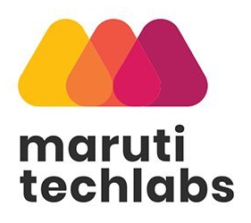

# Devang Parekh

AI Automation Engineer · Toronto

I build agentic systems and the services under them. Reklaim ran through November 2026. Open to the next role.

## Experience

<table width="100%">
<tr>
<td>

<strong>Reklaim Inc.</strong> 
AI Automation Engineer · Toronto · Jun 2026 – Nov 2026
 
 
<strong>−35%</strong> user cost, CA$4,800 → CA$3,100
&nbsp;&nbsp;·&nbsp;&nbsp;
<strong>62</strong> UI components
&nbsp;&nbsp;·&nbsp;&nbsp;
<strong>100%</strong> robotic replies removed
</td>
</tr>
</table>

<table width="100%">
<tr>
<td>

<strong>Playgrnd</strong> 
Full Stack AI Engineer · Toronto · Nov 2025 – May 2026
 
 
<strong>2</strong> agents
&nbsp;&nbsp;·&nbsp;&nbsp;
<strong>98%</strong> of manual work automated
&nbsp;&nbsp;·&nbsp;&nbsp;
<strong>+35%</strong> counterparty profit
&nbsp;&nbsp;·&nbsp;&nbsp;
<strong>6</strong> services
</td>
</tr>
</table>

<table width="100%">
<tr>
<td>

<strong>FIYGE Research Inc.</strong> 
Software Engineer · Toronto · Dec 2024 – Oct 2025
 
 
<strong>500+</strong> tables
&nbsp;&nbsp;·&nbsp;&nbsp;
<strong>+60%</strong> retrieval
&nbsp;&nbsp;·&nbsp;&nbsp;
<strong>300+</strong> APIs
 
<strong>−70%</strong> form time
&nbsp;&nbsp;·&nbsp;&nbsp;
<strong>78s → 22s</strong> latency
&nbsp;&nbsp;·&nbsp;&nbsp;
<strong>−30%</strong> database load
</td>
</tr>
</table>

<table width="100%">
<tr>
<td>

<strong>Maruti Techlabs</strong> 
Software Engineer L2 · Bengaluru · Aug 2021 – Apr 2023
 
 
<strong>3</strong> products, US$800k+
&nbsp;&nbsp;·&nbsp;&nbsp;
<strong>−28%</strong> downtime
&nbsp;&nbsp;·&nbsp;&nbsp;
<strong>25+</strong> mailbox capabilities
</td>
</tr>
</table>

## Work

- **[Agentable.io](https://github.com/BravesDevs/Agentable.io)** — Visual agent builder. Each flow ships as a REST endpoint. Next.js, Mastra, Postgres.
- **[Finlysis](https://github.com/BravesDevs/Finlysis)** — Finance API. Plaid, CSV import, spending analytics. NestJS, Prisma, MySQL.
- **[Infralens](https://github.com/BravesDevs/ConHacks2026)** — Terraform right-sizing, opened as a pull request. FastAPI, React, Postgres. ConHacks 2026.
- **[Gujarati dialect detection](https://github.com/BravesDevs/Gujarati-Accent-Detection)** — Five dialect labels on Gujarati transcripts. Django, Keras.

## Stack

TypeScript, JavaScript, Python, Java, SQL. React, Next.js, Node.js, NestJS, Spring Boot, FastAPI. PostgreSQL, MySQL, MongoDB, Pinecone. AWS, Docker, NGINX.

## Education

**Conestoga College** — Graduate Certificate, Web Development · Kitchener · Sep 2023 – Dec 2024

**Dharmsinh Desai University** — B.E., Computer Engineering · Nadiad · Aug 2018 – May 2021

## Contact

[Portfolio](https://gigforge.io/p/devangparekh) · [LinkedIn](https://linkedin.com/in/bravesdevs) · [X](https://x.com/BravesDevs) · [LeetCode](https://leetcode.com/devangmp) · [Email](mailto:devangparekh2014@gmail.com)
