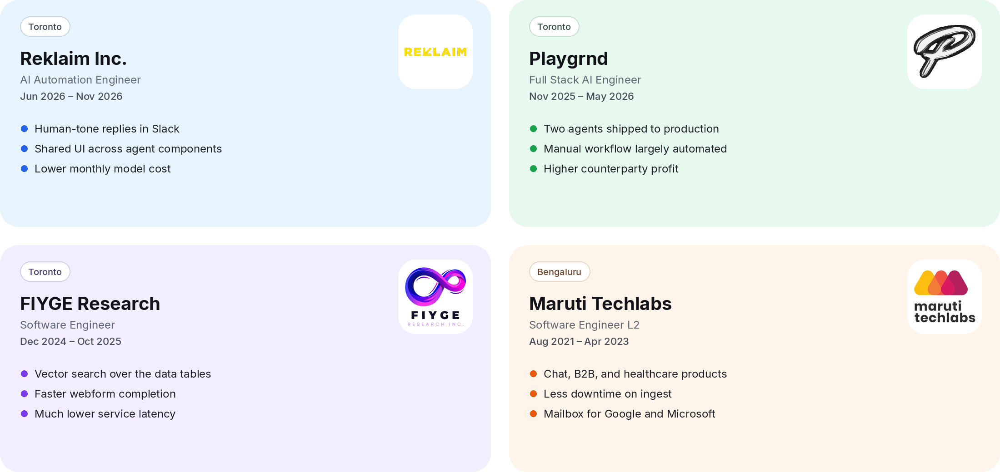
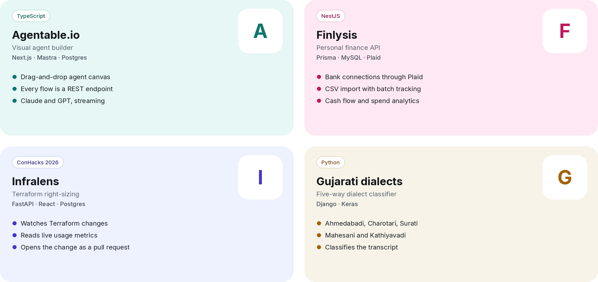

# Devang Parekh

AI Automation Engineer · Toronto

I build agentic systems and the services under them. Reklaim ran through November 2026. Open to the next role.

## Experience

## Work

[Agentable.io](https://github.com/BravesDevs/Agentable.io) · [Finlysis](https://github.com/BravesDevs/Finlysis) · [Infralens](https://github.com/BravesDevs/ConHacks2026) · [Gujarati dialects](https://github.com/BravesDevs/Gujarati-Accent-Detection)

## Stack

 

 

 

## Education

**Conestoga College** — Graduate Certificate, Web Development · Kitchener · Sep 2023 – Dec 2024

**Dharmsinh Desai University** — B.E., Computer Engineering · Nadiad · Aug 2018 – May 2021

## Contact

[Portfolio](https://gigforge.io/p/devangparekh) · [LinkedIn](https://linkedin.com/in/bravesdevs) · [X](https://x.com/BravesDevs) · [LeetCode](https://leetcode.com/devangmp) · [Email](mailto:devangparekh2014@gmail.com)
